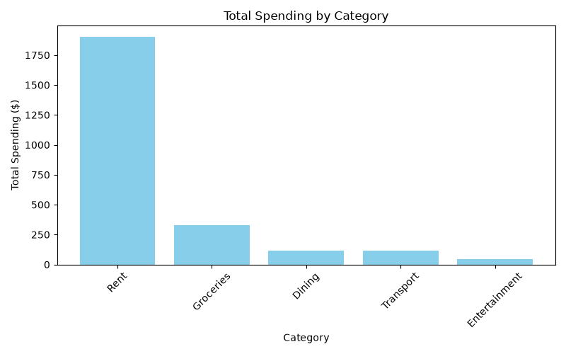

# Personal Finance Data Tracker

A Python tool that loads, cleans, and analyzes personal transaction data from a CSV file. It generates spending summaries by category and month, compares spending across two months, and visualizes trends with charts.

## Features

- **Data cleaning**: loads transaction data from CSV and handles missing values
- **Category summary**: total spending broken down by category
- **Monthly summary**: total spending broken down by month
- **Top transactions**: surfaces the largest individual transactions
- **Month-over-month comparison**: compares total and category-level spending between any two months, showing whether spending went up or down and where
- **Data visualization**: bar chart of spending by category and line chart of spending trend over time

## Example Output

### Spending by Category


### Monthly Spending Trend


## Tech Stack

- Python
- Pandas: data loading, cleaning, and aggregation
- Matplotlib: data visualization

## How to Run

1. Clone the repository:

```
git clone https://github.com/Areebah1022/Personal-Finance-Data-Checker.git
cd Personal-Finance-Data-Checker
```

2. Create and activate a virtual environment:

```
python -m venv venv
venv\Scripts\activate
```

On Mac/Linux, activate with `source venv/bin/activate` instead.

3. Install the dependencies:

```
pip install pandas matplotlib
```

4. Run the script:

```
python main.py
```

## Data Format

The script expects a `transactions.csv` file in the project folder with these columns:

```
date,category,value,description
2026-01-03,Groceries,54.32,Metro
```

Note: there should be no spaces after the commas in the header row.

## What I Learned

This project was my first time using Git and GitHub for version control, and my first time using Pandas for data analysis. It helped me get comfortable with:

- Setting up a Python development environment from scratch
- Structuring code into reusable functions
- Debugging real errors, such as KeyErrors from mismatched column names and PATH issues
- Committing and pushing incremental progress with Git